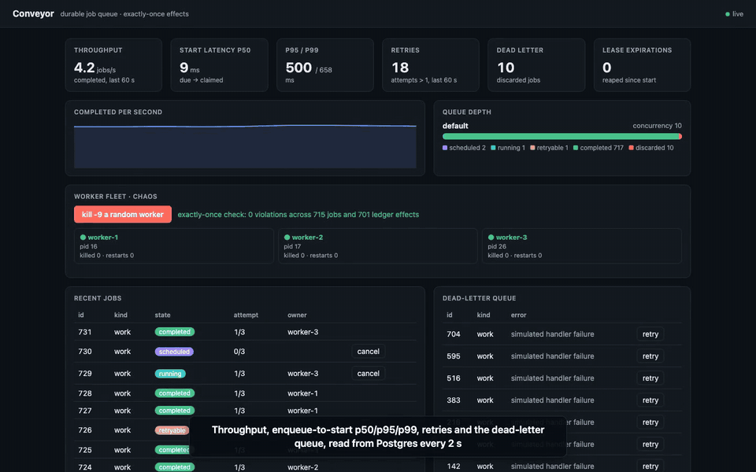
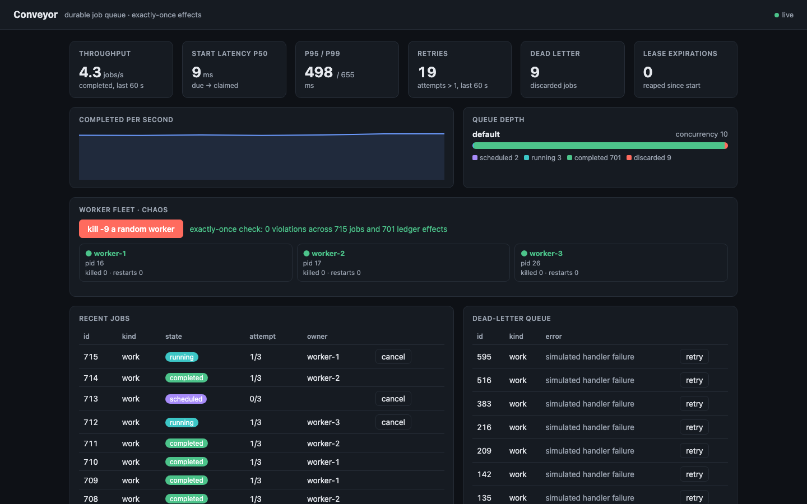
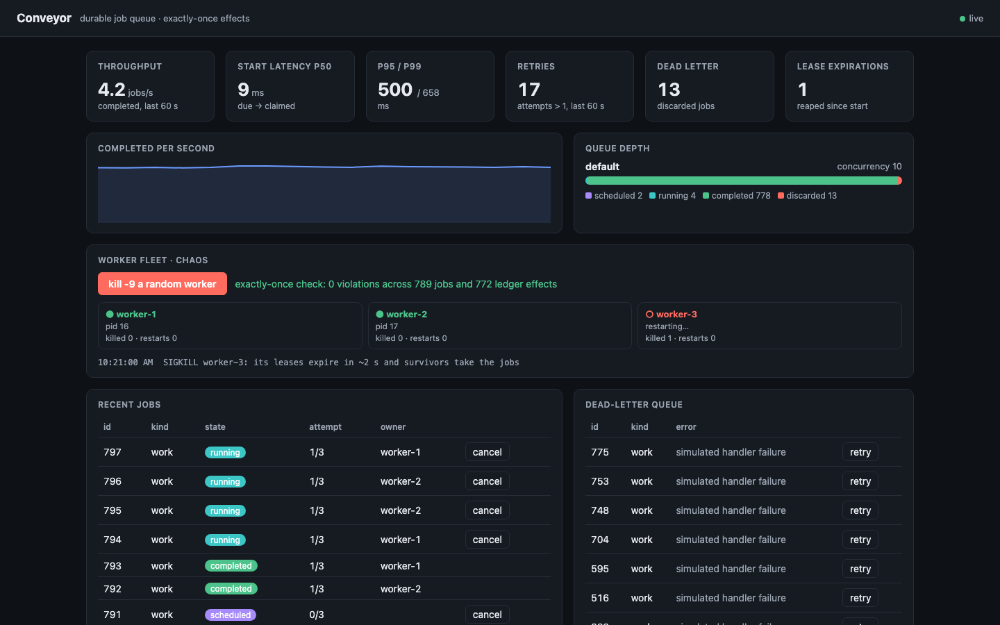
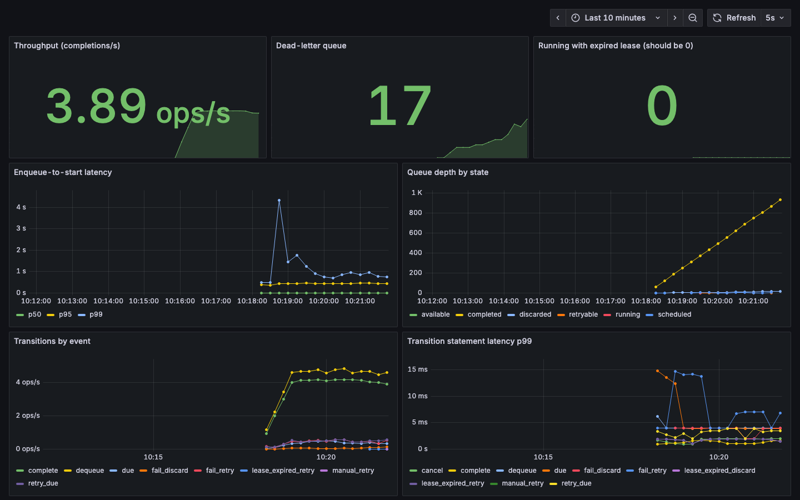
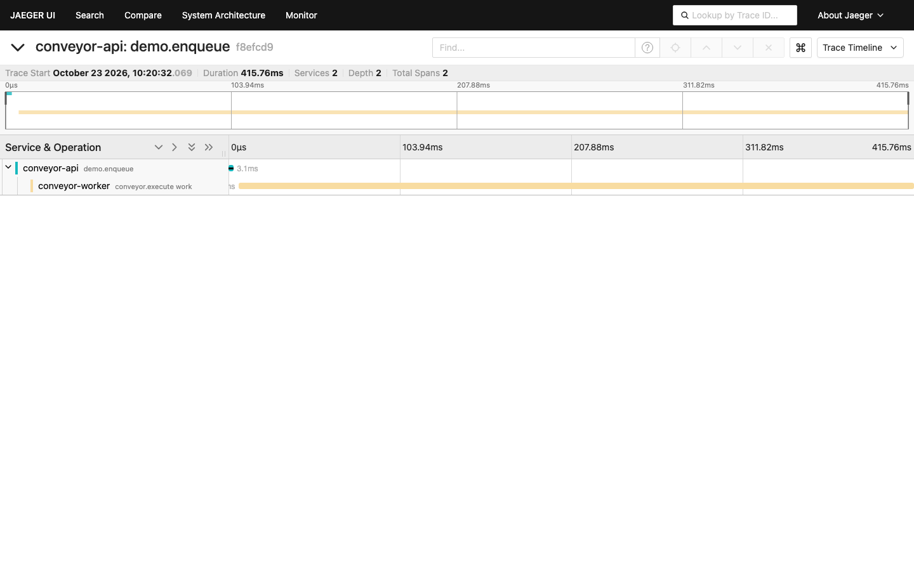
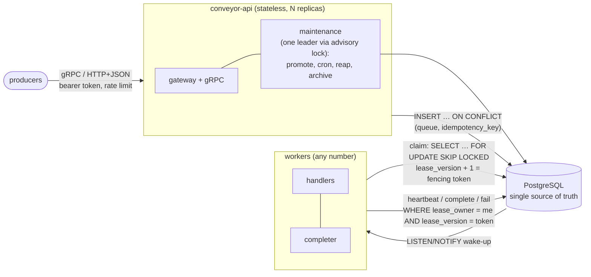
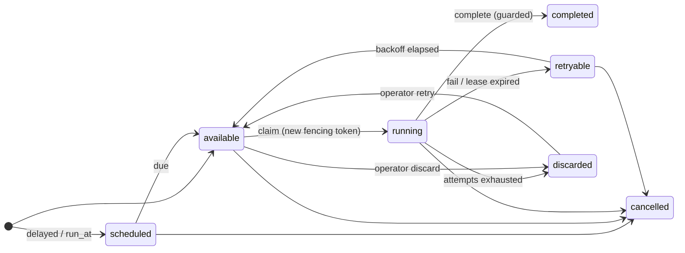

# Conveyor

**A durable, distributed job queue and workflow engine on PostgreSQL, in Go.**

Background work such as sending email, charging cards or running batch jobs must survive crashed
workers, flaky networks and database restarts without being lost or done twice. Conveyor delivers
every job at least once and makes each job's effect happen exactly once, using fencing tokens and
idempotency keys. It checks that claim three ways: a TLA+ model, a fault-injection harness with an
automatic history checker, and the live demo below.



**Demo video (1 min 50 s):** [`docs/media/demo.mp4`](docs/media/demo.mp4). It covers the live dashboard, `kill -9` of a worker and its
recovery, the dead-letter queue, Grafana and an end-to-end trace.
**Live demo:** not deployed yet. The deployment recipe for an Oracle Cloud Always Free VM is in
[`docs/runbook.md`](docs/runbook.md#deploy), and `make demo` runs the same stack locally.

| Live dashboard | Recovery after `kill -9` |
|---|---|
|  |  |
| **Grafana** | **One trace across processes** |
|  |  |

---

## Results

Every figure below is produced by a committed script, and `internal/quality` fails CI if the
README drifts from the committed result files. All runs used one Apple M5 laptop (10 cores,
16 GB), Go 1.27, and Postgres 17 in Docker Desktop on the same machine, on 2026-10-23.

| What | Result | Baseline | How it was measured | Reproduce |
|---|---|---|---|---|
| Throughput, no-op jobs, end to end | **2697 ± 107** jobs/s | River v0.49.0: 1921 ± 918 (1 ms fetch cooldown), 321 ± 0 (default) | 2000 jobs × 5 reps, 4 producers, 4 worker loops × 8 slots; mean ± 95% CI | `scripts/bench.sh` |
| Enqueue-to-start latency | p50 **5.0 ms**, p99 **12.4 ± 1.2** ms | River (1 ms cooldown): p50 2.5 ms, p99 12.3 ± 14.9 ms | same runs; enqueue timestamp to handler start | `scripts/bench.sh` |
| Bottleneck fix: batched, fenced completions | **2024 ± 138 → 2697 ± 107** jobs/s | completion per commit | same runs; Postgres wait events sampled every 10 ms | `scripts/bench.sh` |
| Faults survived | **1000 / 1000** jobs completed, **1000** effects, **0** violations | must be 0 lost and 0 duplicated | 5 runs × 200 jobs under kill -9, SIGSTOP, partition, latency and resets, Postgres restart, clock skew | `make fault` |
| Protocol model | **0 errors** in 19,530 states; the unfenced mutant **is caught** | must find a zombie when fencing is removed | TLC: 5 invariants, an action property and liveness | `make tlc` |

### Throughput and latency sweep

`scripts/bench.sh` starts a fresh Postgres container and runs every configuration below for
5 reps of 2000 jobs. Throughput is jobs divided by the time from the first enqueue to the last
handler start. Latency runs from the enqueue timestamp carried in the job to the handler's start,
both read from the same process clock. Raw per-rep data, wait-event samples and the exact
commands are in [`results/bench-2026-10-23.json`](results/bench-2026-10-23.json).

<!-- results:bench -->
| configuration | jobs/s (± 95% CI) | p50 ms | p95 ms | p99 ms (± 95% CI) |
|---|---|---|---|---|
| conveyor baseline | 2697 ± 107 | 5.0 | 9.9 | 12.4 ± 1.2 |
| conveyor before: completion per commit | 2024 ± 138 | 5.4 | 9.8 | 12.7 ± 1.5 |
| conveyor notify per enqueue | 1545 ± 86 | 4.9 | 7.1 | 9.3 ± 1.7 |
| conveyor workers=1 | 1879 ± 510 | 278.9 | 398.1 | 410.5 ± 135.6 |
| conveyor workers=2 | 2886 ± 77 | 4.6 | 9.2 | 11.4 ± 1.1 |
| conveyor workers=8 | 2611 ± 87 | 5.1 | 10.1 | 12.3 ± 0.5 |
| conveyor workers=16 | 1230 ± 124 | 5.6 | 11.1 | 15.9 ± 3.2 |
| conveyor batch=1 | 2244 ± 96 | 11.8 | 20.9 | 22.3 ± 9.3 |
| conveyor batch=32 | 2599 ± 457 | 7.1 | 12.3 | 14.3 ± 3.1 |
| conveyor payload=16384 | 1635 ± 387 | 6.8 | 13.4 | 17.2 ± 5.6 |
| conveyor payload=65536 | 1061 ± 22 | 9.8 | 16.8 | 19.8 ± 0.5 |
| river default (fetch cooldown 100ms) | 321 ± 0 | 2786.9 | 5327.7 | 5596.8 ± 19.1 |
| river fetch cooldown 1ms | 1921 ± 918 | 2.5 | 4.3 | 12.3 ± 14.9 |
<!-- /results:bench -->

**What the numbers say**

- **The bottleneck is WAL flushing.** Each job takes three durable commits: enqueue, claim and
  completion. Sampling `pg_stat_activity` puts `LWLock:WALWrite` and `IO:WalSync` at the top after
  CPU. Batching completions into one fenced `UPDATE … FROM unnest(ids, tokens)` per worker
  ([ADR 0004](docs/adr/0004-batch-completions-to-amortise-wal-flushes.md)) raised throughput by a
  third and cut the WAL-lock share of waits from 27% to 16%. WAL flushing is still about 40% of
  samples, so the next gains come from fewer commits per job, not from more workers.
- **More workers is not faster past the WAL limit.** Two to eight worker loops are within noise of
  each other, and 16 loops lose more than half the throughput to CPU and WAL contention. A single loop
  cannot keep up, so its latency is backlog.
- **Wake-ups matter.** Notifying on every enqueue costs 43% of throughput. The debounced
  notification has a trailing edge, so no job waits for the 200 ms poll; an earlier
  leading-edge-only version did, and `TestNotifyDebounceHasTrailingEdge` now guards against that.
- **River comparison.** With its default 100 ms fetch cooldown, River trades latency for fewer
  fetch queries and queues up behind this workload. With 1 ms it is close to Conveyor, with a
  better median, a similar p99 and a wide run-to-run spread. River's job rows also carry more
  (metadata, attempt history), so this compares the two at their defaults and at one tuned
  setting, not the cost of identical work.

### Fault injection

[`internal/fault`](internal/fault/harness_test.go) runs four real `harness-worker` processes. They
reach Postgres through [Toxiproxy](https://github.com/Shopify/toxiproxy), and each run injects, in
order:
1. 30 ms latency with 10 ms jitter, and 5% connection resets, for the whole run;
2. a Postgres restart;
3. `kill -9` of one worker;
4. `SIGSTOP` of another for 2.5 leases, after which it resumes as a zombie;
5. a 4 s network partition.

A fourth worker runs the whole time with a clock four times slow relative to its lease. Each job's
effect is a ledger row committed in the same transaction as its completion. The
[checker](internal/checker/checker.go) then reads the history and fails the run unless every job
is terminal, every completed job has exactly one ledger row carrying its final fencing token, and
no other job has any. Raw data: [`results/fault-2026-10-23.json`](results/fault-2026-10-23.json).

<!-- results:fault -->
| run | jobs | completed | ledger effects | violations | lease expirations | jobs claimed twice or more | max fencing token | drained in |
|---|---|---|---|---|---|---|---|---|
| 1 | 200 | 200 | 200 | 0 | 43 | 31 | 6 | 69 s |
| 2 | 200 | 200 | 200 | 0 | 37 | 27 | 5 | 62 s |
| 3 | 200 | 200 | 200 | 0 | 38 | 28 | 5 | 65 s |
| 4 | 200 | 200 | 200 | 0 | 39 | 28 | 5 | 65 s |
| 5 | 200 | 200 | 200 | 0 | 36 | 27 | 5 | 62 s |
<!-- /results:fault -->

Up to 31 jobs per run were executed by more than one worker, and none had its effect applied
twice. That is the difference between at-least-once delivery and exactly-once effects.

### Formal model

[`spec/tla/Conveyor.tla`](spec/tla/Conveyor.tla) models enqueue with idempotency keys, claim,
heartbeat, lease loss and expiry, the reaper, completion, failure, retry, and crash and restart.
TLC checks it in CI for:
- one job per idempotency key;
- at most one current lease holder;
- an effect exactly when a job completes;
- outcomes decided only by the current holder or the reaper;
- every job eventually terminal.

[`scripts/tlc.sh`](scripts/tlc.sh) then removes the fencing check from the model and requires TLC
to find the resulting zombie write, so the model cannot pass vacuously. Output:
[`results/tlc-2026-10-23.txt`](results/tlc-2026-10-23.txt). What it does and doesn't cover:
[`spec/tla/README.md`](spec/tla/README.md).

---

## How it works





Every state change is one guarded `UPDATE` whose source and target states come from
[`internal/statemachine`](internal/statemachine/statemachine.go), so the SQL cannot perform a
transition the table doesn't allow.

**Why exactly-once *delivery* is impossible, and what Conveyor guarantees instead.** A worker
cannot tell "the database never got my acknowledgement" from "it did, and the reply was lost".
That is the Two Generals problem, so some job will eventually run twice. Conveyor makes the
second run harmless:

1. **Claiming issues a fencing token.** A claim increments `lease_version`, and every later write
   about the job (heartbeat, complete, fail) must present the owner *and* that token.
2. **Leases expire.** A worker that dies, pauses or is partitioned stops heartbeating. The reaper
   re-queues its jobs, and the next claim issues a higher token.
3. **The effect commits with the completion.** A handler writes its side effect and calls
   `CompleteTx` in one transaction. A zombie holding the old token matches no row, so its whole
   transaction rolls back and it commits neither.
4. **Idempotency keys make enqueue safe to retry.** The key is unique per queue, so producers can
   retry blindly.

Effects outside Postgres, such as a payment API, must pass the job's idempotency key or fencing
token to that system. No queue can make those exactly-once alone. The full argument and the
alternatives considered (Redis, Kafka, a database-agnostic design, adopting River) are in
[`docs/design.md`](docs/design.md).

---

## Quick start

Requirements: Go 1.27, Docker.

```bash
make demo                               # Postgres + API (demo mode) + Caddy TLS on https://localhost
open https://localhost                  # accept the local CA certificate; live load and the chaos button
docker compose -f compose-demo.yml --profile observability up -d   # + Prometheus, Grafana :3000, Jaeger :16686
```

```bash
export CONVEYOR_API_TOKEN=change-me-token          # from .env
go run ./cmd/conveyor enqueue --queue default --kind work --args '{"ms":200}' --idempotency-key order-42
go run ./cmd/conveyor enqueue --queue default --kind work --depends-on 1 --delay 30s
go run ./cmd/conveyor stats
curl -s -H "Authorization: Bearer $CONVEYOR_API_TOKEN" localhost:8080/v1/jobs -d '{"queue":"default","kind":"work"}'
```

A worker, with an effect that commits exactly once:

```go
w := worker.New(db, dsn, "payments", "worker-1",
	worker.WithLease(30*time.Second), worker.WithHandlerCommitsOutcome())
w.Handle("charge", func(ctx context.Context, j worker.Job) error {
	tx, err := db.BeginTx(ctx, nil)
	if err != nil {
		return err
	}
	defer tx.Rollback()
	if _, err := tx.ExecContext(ctx, `INSERT INTO charges (order_id, amount) SELECT …`, j.Args); err != nil {
		return err // retried with exponential backoff and jitter, then dead-lettered
	}
	if err := w.CompleteTx(ctx, tx, j); err != nil {
		return err // we lost the lease: another worker owns this job, so nothing commits
	}
	return tx.Commit()
})
err := w.Run(ctx) // returns after a graceful drain when ctx is cancelled
```

A producer, through the typed SDK:

```go
c, _ := client.New("conveyor.example.com:443", client.WithToken(token), client.WithTLS(&tls.Config{}))
id, deduped, err := c.Enqueue(ctx, "payments", "charge", order,
	client.EnqueueOptions{IdempotencyKey: order.ID, MaxAttempts: 5, Priority: 10})
```

### Development

| command | does |
|---|---|
| `make test` | all tests with the race detector, including integration tests on real Postgres (testcontainers) and the fault harness |
| `make test-short` / `make cover` | without the fault harness / with core coverage (CI requires at least 85%) |
| `make lint` | gofmt, go vet, staticcheck, golangci-lint |
| `make vuln` | govulncheck |
| `make tlc` | TLC model check and mutation check |
| `make bench` / `make fault` | regenerate `results/bench-*.json` / `results/fault-*.json` |
| `make proto` | regenerate the gRPC, gateway and protobuf code |

CI runs every one of these on each pull request. It also runs a Trivy scan of the image and the
repository, and an end-to-end smoke test of the demo stack: TLS, auth, a job surviving a chaos
kill, the invariant check, and metrics.

---

## Features

- **Delivery:** at-least-once delivery with exactly-once effects (fencing tokens plus idempotency
  keys); leases with heartbeats and automatic recovery from crashed or paused workers.
- **Scheduling:** priorities; delayed and scheduled (`run_at`) jobs; cron schedules that stay
  idempotent across leader fail-over; retries with exponential backoff and full jitter; a
  dead-letter queue; cancellation, including of running jobs.
- **Limits and workflows:** per-queue concurrency and rate limits; workflows in which a job runs
  once its dependencies complete, and is cancelled if one is discarded.
- **Interfaces:** a gRPC API with an HTTP/JSON gateway, a typed Go SDK ([`client`](client/)), a
  worker library with graceful shutdown ([`worker`](worker/)), a CLI ([`cmd/conveyor`](cmd/conveyor/))
  and a web dashboard.
- **Scaling:** stateless API replicas, any number of workers, and one maintenance leader elected
  by a Postgres advisory lock, with automatic fail-over.
- **Retention:** terminal jobs are archived after a day, so the hot table and its partial indexes
  stay small.

## Operations and security

- **Metrics:** Prometheus metrics for queue depth, transitions and their latency, enqueue-to-start
  latency, retries, dead letters, lease expirations, leader changes, and API rate, errors and
  duration. The Grafana dashboard is [`dashboards/conveyor.json`](dashboards/conveyor.json).
- **Tracing:** OpenTelemetry traces, with the trace context stored in each job, so one trace runs
  from the API request to the job's execution on another machine.
- **Logs and health:** structured JSON logs with request IDs; `/healthz`, `/readyz` and gRPC
  health.
- **Access control:** a bearer token compared in constant time, an optional public read mode for
  the demo, and a per-IP rate limit.
- **Input validation:** 64 KiB argument and body limits, and validation of every input.
- **Least privilege and transport:** the schema owner runs migrations, and the runtime role has
  DML rights only ([`deploy/initdb`](deploy/initdb/01-roles.sh)). TLS terminates at Caddy, and
  the image is a distroless, non-root container.
- **Documentation:** the threat model is in [`docs/design.md` §13](docs/design.md#13-threat-model-summary),
  operations in [`docs/runbook.md`](docs/runbook.md), and decisions in [`docs/adr/`](docs/adr/).

## Limitations

- **One Postgres.** No multi-region replication, and throughput is bounded by one primary's WAL:
  about 2.7k no-op jobs/s on a laptop, short of the 5k target set in the design. The ways forward
  are batching enqueues, fewer commits per job, relaxed `synchronous_commit` for queues that
  tolerate it, and sharding queues across databases. None of these is built.
- **Exactly-once covers effects in the same Postgres transaction.** External side effects need
  the downstream system to deduplicate on the idempotency key or fencing token.
- **Scheduling granularity.** Scheduled jobs and retries become runnable on the leader's 500 ms
  tick, so they can start up to half a second after they are due. In the demo's mixed workload
  this dominates p95. Immediate jobs are woken by NOTIFY.
- **Queue limits are approximate.** The concurrency limit can over-admit by one batch per
  concurrent dequeuer, and the rate limit is a minimum interval between claims, not a token
  bucket.
- **Shared API token.** The token is shared rather than issued per client. The per-IP rate limit
  trusts the first `X-Forwarded-For` hop, which is set by the TLS proxy in the supported
  deployment.
- **Model scope.** The TLA+ model is bounded (three jobs, two workers, one crash) and abstracts
  SQL, timing, priorities, cron and workflows. Those are covered by tests instead.
- **Measurement setup.** The benchmarks ran on a laptop with Postgres in a Docker VM on the same
  machine. Absolute numbers will differ on server hardware; the comparisons are like for like.

## Repository layout

```
api/proto/conveyor/v1   protobuf service and generated gRPC, gateway and message code
client/                 Go SDK
worker/                 worker library
cmd/                    conveyor-api, conveyor (CLI), harness-worker, loadgen, riverbench
internal/queue          enqueue, claim, leases, fencing, retries, workflows, cron, stats
internal/statemachine   the only definition of states and transitions
internal/maintenance    leader election and the maintenance loop
internal/api            gRPC service, auth, rate limiting, request logging
internal/checker        history checker used by the fault harness and the demo
internal/fault          fault-injection harness (Toxiproxy, signals, restarts, clock skew)
internal/demo           demo-mode workload, worker supervisor and chaos endpoint
internal/telemetry      OpenTelemetry setup and trace propagation through jobs
internal/quality        README-versus-results drift checks
migrations/             versioned SQL, embedded in the binary
spec/tla/               TLA+ model and TLC configuration
deploy/                 Postgres roles, Caddy, Prometheus and Grafana provisioning
dashboards/             Grafana dashboard
results/                benchmark, fault-injection and TLC outputs
docs/                   design document, ADRs, runbook, demo media
```
